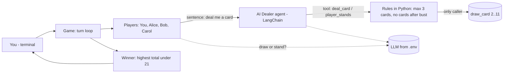
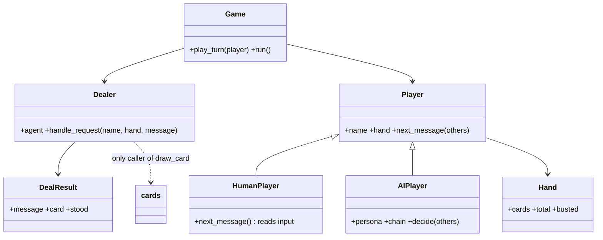
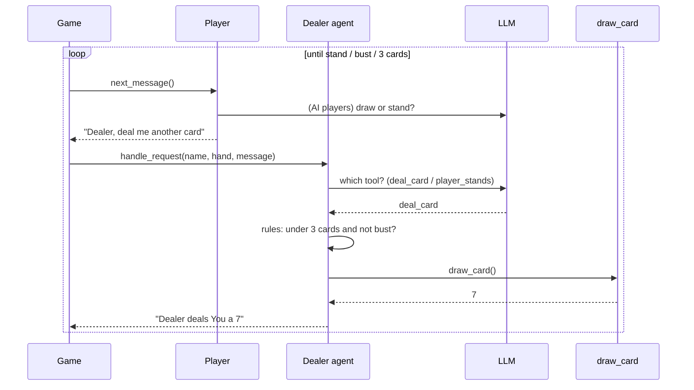

# Blackjack with AI Agents (terminal, Python 3.12+, LangChain)

A simplified Blackjack played entirely in the terminal: **you + 3 AI players** (Alice, Bob, Carol)
and **one AI dealer agent**.

* Each player may draw **up to 3 cards** (a card is a random number 2–11).
* Players **cannot draw cards themselves** – they ask the dealer in plain English
  ("deal me the next card"). Only the dealer calls `draw_card()`.
* After everyone has played, the winner is the **highest total under 21**
  (ties are announced; if nobody finishes under 21 there is no winner).
* The AI players decide for themselves whether to draw again, each with its own personality.

> Following the instructions literally: only totals **strictly under 21** can win. A total of 21 or more is a bust.
> To allow exactly 21, change `busted` in `blackjack/models.py` to `self.total > LIMIT`.

## 1. How to run

```bash
# 1. create and activate a virtual environment (optional)
python -m venv .venv
.venv\Scripts\activate              # Windows   (Linux/Mac: source .venv/bin/activate)

# 2. install
pip install -r requirements.txt

# 3. add your API key
# update .env --> open .env and replace  your-anthropic-api-key-here and openai key with your real key             


# 4. play
python -m blackjack.main
```

| Option | Meaning |
|---|---|
| `--offline` | No LLM, simple rule-based agents (free). Also used automatically if no real API key is set |
| `--auto` | Makes "You" a bot too (for a quick demo) |
| `--seed 3` | Same cards every run |

**On your turn type things like:** `deal me the next card`, `hit me`, `one more please`, `I'll stand`, `I'm good`.

Run the tests (no API key needed): `python -m pytest -q`

### Which LLM?
Set in `.env` (placeholders provided). Recommended: **Claude Haiku 5.5** (`claude-haiku-5-5`) – small, fast, cheap,
good at tool-calling. Alternatives: `gpt-4o-mini` (OpenAI), `gemini-2.0-flash` (Google). The replies are tiny,
so a whole game costs very little.

## 2. How LangChain is used

| LangChain feature | File | Purpose |
|---|---|---|
| `init_chat_model` | `llm.py` | Create the chat model for Anthropic / OpenAI / Google from `.env` |
| `create_agent` + `@tool` | `dealer.py` | **The dealer is a LangChain agent**; it reads a message and chooses the tool `deal_card` or `player_stands` |
| `ChatPromptTemplate` + `with_structured_output` (a chain) | `players.py` | Each AI player's "brain": prompt → LLM → `{action, say}` |

## 3. High-Level Design (HLD)



Design ideas
* **Players only talk; the dealer acts.** The card function is called from exactly one place.
* **The LLM decides, code enforces.** The 3-card limit and bust check are normal Python, so the LLM can't give extra cards.
* **Always runs.** With no API key (or if the API fails) simple keyword/threshold logic takes over.

## 4. Low-Level Design (LLD)

| File | What it does |
|---|---|
| `blackjack/cards.py` | `draw_card()` – the provided random 2..11 function |
| `blackjack/models.py` | `Hand`, `DealResult`, constants `MAX_CARDS=3`, `LIMIT=21` |
| `blackjack/llm.py` | Builds the LLM from `.env` (or `None` = offline) |
| `blackjack/dealer.py` | `Dealer`: LangChain agent + rule engine |
| `blackjack/players.py` | `HumanPlayer`, `AIPlayer` (LangChain chain) |
| `blackjack/game.py` | Turn loop and `pick_winners()` |
| `blackjack/main.py` | Command-line entry point |
| `tests/` | Offline tests (winner rules, dealer rules, agent and chain with fake models) |

### Class diagram


### Sequence: one player's turn


### Winner rule
Hands of 21 or more (bust) can't win → the highest remaining total wins → equal totals are a tie → all bust = no winner.
